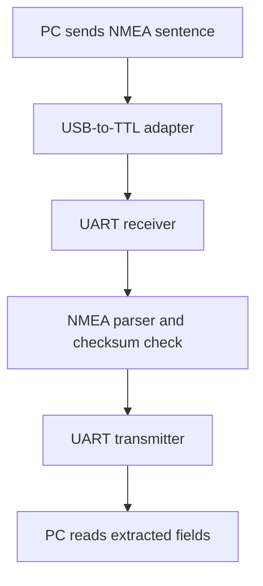

# NMEA Sentence Parser on FPGA

A Verilog implementation of an NMEA sentence parser for the Digilent Zybo Z7. The design accepts NMEA text through a UART connection, checks the sentence checksum, extracts selected GGA fields, and sends the extracted values back over UART.

This repository contains the parser design, UART modules, checksum logic, a simulation testbench, and the board constraint file.

## What the Design Does

An external USB-to-TTL serial adapter connects a host computer to the FPGA. Incoming characters are received at 115200 baud and passed to a finite state machine (FSM). The parser starts a new sentence when it receives `$`, separates fields at commas, and compares its calculated XOR checksum with the two hexadecimal characters following `*`.

When the checksum matches, the FPGA transmits the extracted fields back to the host computer. Each field is sent on its own line. A sentence with an invalid checksum does not produce the parsed UART output.

## Extracted GGA Fields

The current parser stores and returns these fields in order:

1. Message ID
2. UTC time
3. Latitude
4. Latitude direction
5. Longitude
6. Longitude direction
7. GPS quality
8. Number of satellites
9. HDOP
10. Altitude

The transmitted fields use fixed buffer lengths and are separated by CRLF (`\r\n`).

## Hardware Configuration

| Item | Configuration |
| --- | --- |
| Board | Digilent Zybo Z7 |
| FPGA clock used by the design | 125 MHz |
| UART baud rate | 115200 bps |
| UART input | `uart_rxd` |
| UART output | `uart_txd` |
| Reset input | `btn_rst` |
| Constraint file | `Zybo-Z7-Master.xdc` |

In the supplied XDC file, `uart_rxd` is assigned to `JE[1]` and `uart_txd` to `JE[2]`. Check the exact Zybo Z7 board variant and connector wiring before programming the FPGA.

Connect the serial adapter's **TX to the FPGA RX**, its **RX to the FPGA TX**, and **GND to GND**. Use a USB-to-TTL adapter with a compatible 3.3 V logic level.

## LED Indicators

| LED | Meaning in this implementation |
| --- | --- |
| LED0 | No UART byte has been received for the configured timeout; default: 5 seconds |
| LED1 | The received NMEA checksum is valid |
| LED2 | The received NMEA checksum is invalid |
| LED3 | UART receiver activity (`rx_ready`) |

## Files

| File | Purpose |
| --- | --- |
| `nmea_parser.v` | Top-level FSM, GGA field buffers, output sequencing, and bundled UART/checksum module definitions |
| `uart_rx.v` | Standalone UART receiver module |
| `uart_tx.v` | Standalone UART transmitter module |
| `checksum.v` | Standalone `checksum_validator` module |
| `nmea_parser_tb.v` | Self-checking simulation testbench |
| `Zybo-Z7-Master.xdc` | Clock, reset, LED, Ethernet reset, and UART pin constraints |

**Vivado source note:** The current `nmea_parser.v` already includes the definitions of `uart_rx`, `uart_tx`, and `checksum_validator`. If you use this file as supplied, add **only `nmea_parser.v`** as a design source. Keep the three standalone files in the repository, but do not add them to the same Vivado source set. Alternatively, remove the bundled module definitions from `nmea_parser.v` before using the standalone versions.

## Simulation

Set `nmea_parser_tb.v` as the simulation top module (`tb_nmea_parser`). The testbench covers:

- A GGA sentence with a valid checksum (`*4F`)
- The same sentence with an incorrect checksum (`*00`)
- A valid checksum written with a lowercase hex character (`*4f`)
- The extracted field buffers and the UART transmission sequence

The testbench injects received bytes internally. It checks the parsing and response logic, but it does not simulate the electrical connection from the external serial adapter into the UART RX pin.

## Running on the Board

1. Create a Vivado project for your exact Zybo Z7 board variant.
2. Add `nmea_parser.v` as the design source and set `nmea_parser` as the top module.
3. Add `Zybo-Z7-Master.xdc` as the constraint file.
4. Review the active pin assignments against your board and serial adapter wiring.
5. Run synthesis and implementation, generate the bitstream, and program the FPGA.
6. Send an NMEA GGA sentence from a serial terminal or a host-side script at **115200 baud**.
7. Read the returned fields on the serial monitor and observe the LED indicators.

A host-side Python sender is not included in this repository yet. It can be added later as a separate file.

## Current Scope

The implementation focuses on selected fields from GGA sentences. It does not convert the latitude and longitude strings into decimal degrees, and the repository does not include evidence of a complete physical hardware validation.
